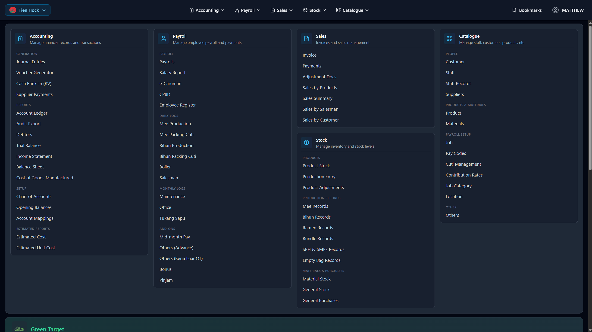
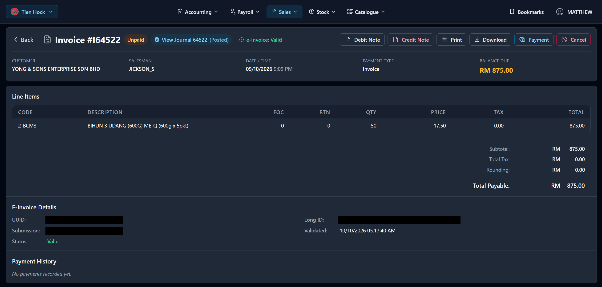
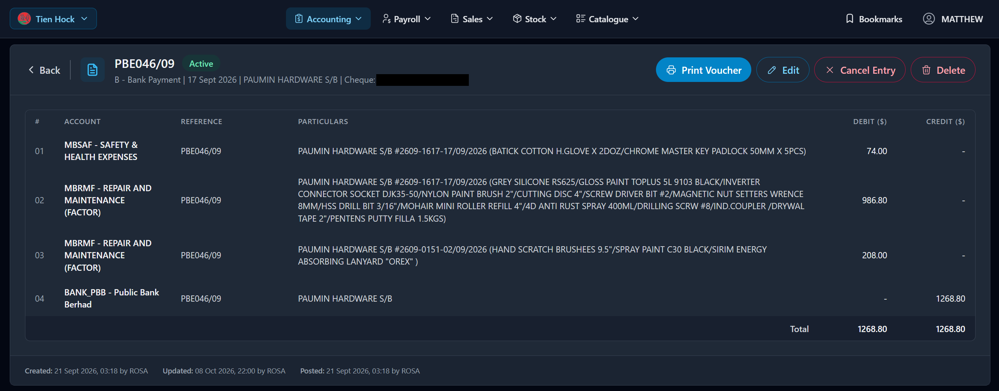
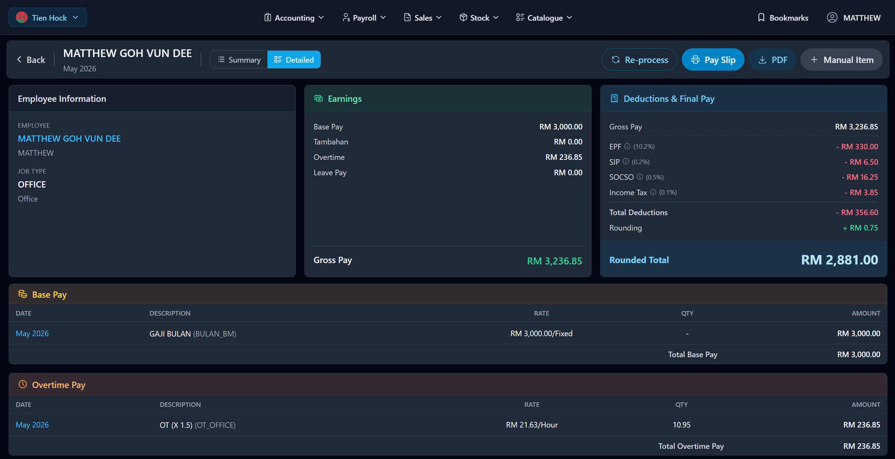
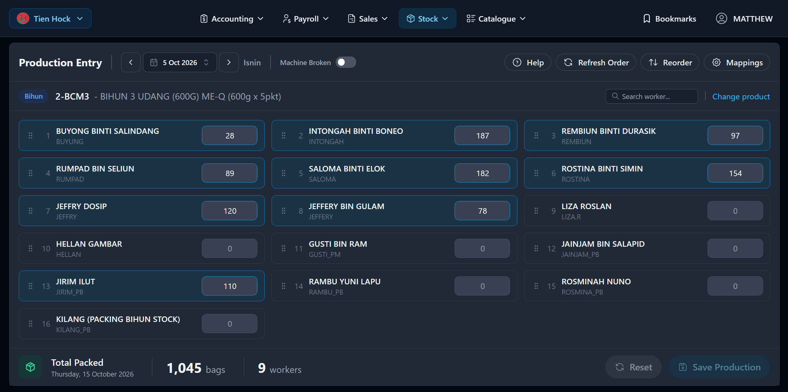
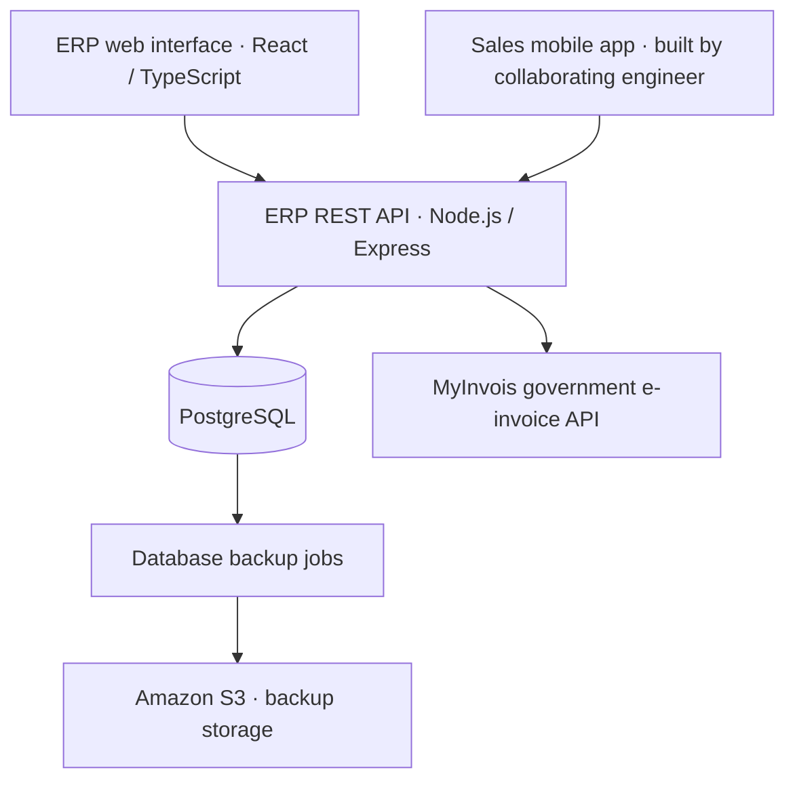

# Tien Hock ERP | Business Management System

[中文](README.md) · English

A production ERP developed and maintained for **Tien Hock** and related businesses, covering **accounting, sales, payroll, and inventory**.

**Operational use: 3 businesses · 8+ staff managing sales, accounting, payroll, and inventory.**

This repository is a project case study. It does not contain production source code or database exports.

## My role

**Matthew Goh | Full-stack development and operations**

- Owned ERP requirements, technical design, frontend and backend development, deployment, and ongoing maintenance.
- Built the React / TypeScript management interface, Node.js / Express APIs, and PostgreSQL data layer.
- Collaborated with a mobile engineer to integrate the sales team's invoicing app, bringing 400+ sales invoices per month into the ERP. **The other engineer built the mobile app; I built the ERP-side APIs and integration.**
- Main development period: June 2024–August 2026, followed by occasional remote maintenance while continuing my studies in the United States.

## Business coverage

| Area | Capabilities |
| --- | --- |
| Sales and customers | Sales invoices, customer and product records, customer-specific pricing, collections and outstanding balances, mobile APIs |
| Accounting | Double-entry posting for sales, receipts, and purchases; links between business documents and journals; ledgers and financial reports |
| Payroll | Employee records, work logs, pay items, statutory deductions, and payroll reports |
| Inventory | Production- and sales-related stock, material stock, and month-end stock data |
| Electronic invoicing | Integration with Malaysia's MyInvois government API for e-invoice submission and status tracking |

The web interface supports English, Malay, and Simplified Chinese. Business documents, financial reports, and payroll reports can be generated and printed as PDFs.

## Screenshots

These captures show the actual application in English; [中文](README.md#界面展示) provides the corresponding Simplified Chinese views. Names and descriptions in business records retain their original language.

Click any screenshot to view it at full size.

### System overview

A shared entry point brings together accounting, payroll, sales, inventory, and catalogue management, alongside access to related businesses.

### Sales and e-invoicing

Invoice details bring together line items, outstanding balances, linked accounting journals, e-invoice status, and payment history.

### Accounting

A bank-payment journal shows accounts, particulars, debit and credit entries, and an activity trail, with editing and voucher-printing controls.

### Payroll

An employee's payroll brings together base pay, overtime, deductions, and take-home pay, with a breakdown of individual pay items.

### Production and inventory

Production entry records each worker's packing quantities by date and product, with totals for packed goods and participating workers.

## Architecture

Cloudflare Pages hosts the frontend; Hetzner hosts the backend, with backend deployment automated through GitHub Actions.

## Technology

- **Frontend:** React, TypeScript, Tailwind CSS, react-i18next
- **Backend:** Node.js, Express, REST APIs
- **Database:** PostgreSQL
- **Deployment and backups:** GitHub Actions, Cloudflare Pages, Hetzner, Amazon S3

[GitHub: matt-goh](https://github.com/matt-goh)
