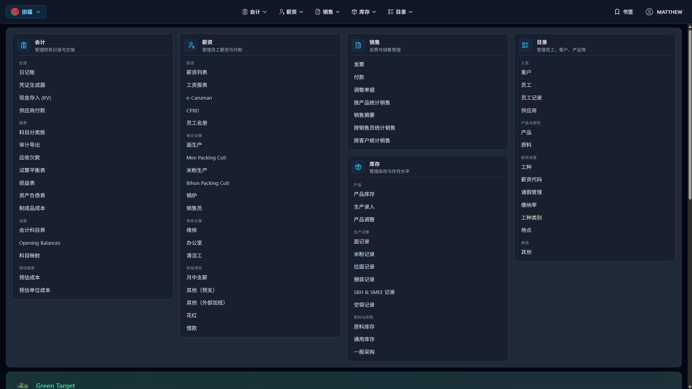
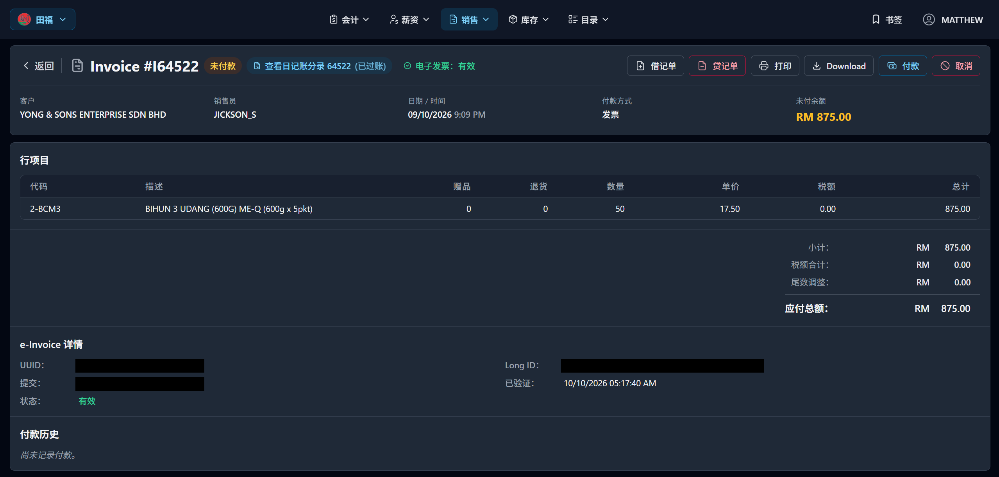
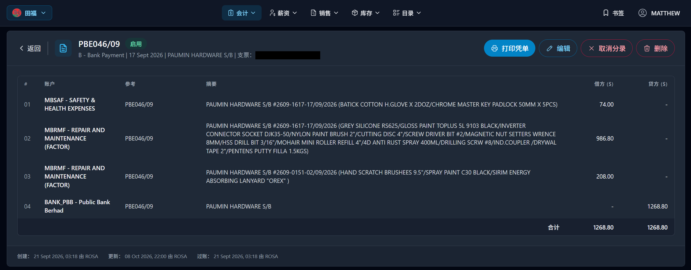
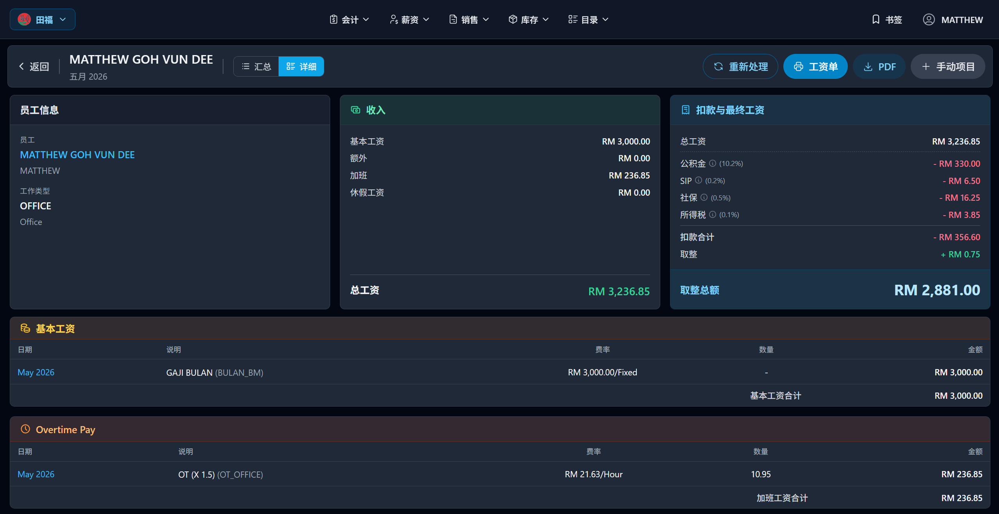
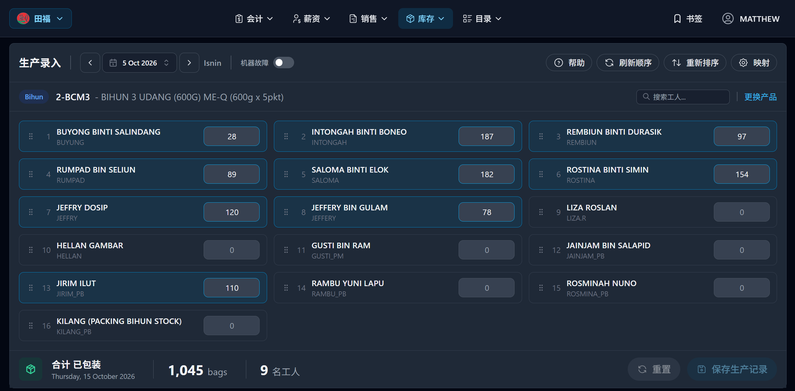
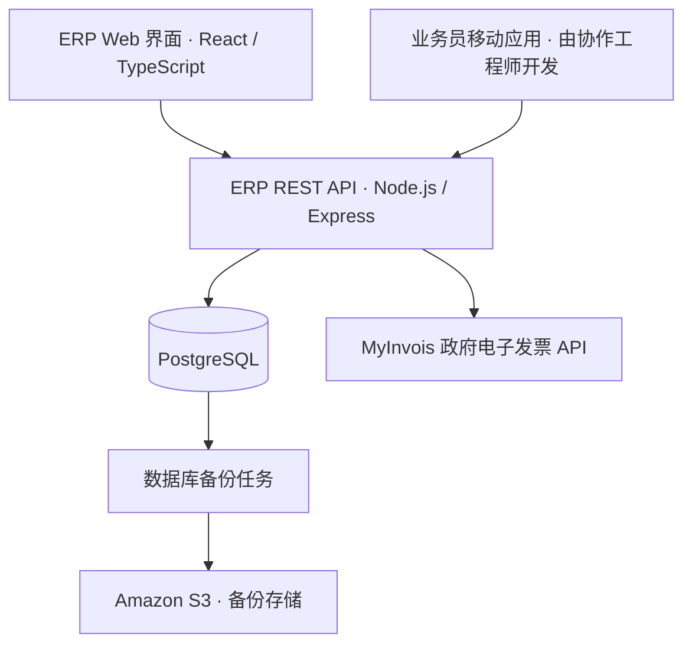

# 田福 ERP｜企业资源管理系统

中文 · [English](README.en.md)

为田福食品工业有限公司（Tien Hock）及关联企业开发并运维的生产业务系统，覆盖**财务会计、销售、薪资和库存管理**。

**实际使用：3 家企业 · 8 名以上员工使用系统管理销售、财务会计、薪资和库存。**

本仓库为项目案例展示，不包含生产源代码或数据库导出文件。

## 我的职责

**吴文迪 Matthew Goh｜全栈开发与运维**

- 负责 ERP 的需求梳理、技术设计、前后端开发、部署及后续维护。
- 开发 React / TypeScript 管理界面、Node.js / Express API 和 PostgreSQL 数据层。
- 与一名移动端工程师协作，将业务员使用的开单应用接入 ERP，每月接收 400 余张销售单据。**移动应用由该工程师开发，我负责 ERP 侧接口与集成。**
- 主要开发阶段为 2024 年 6 月至 2026 年 8 月；赴美继续学业后，仍按需远程维护。

## 系统覆盖哪些业务？

| 模块 | 主要功能 |
| --- | --- |
| 销售与客户 | 销售单据、客户与商品资料、客户定价、收款与欠款管理、移动端接口 |
| 财务会计 | 销售、收款和采购的复式记账，关联业务单据与会计凭证，账簿及财务报表 |
| 薪资管理 | 员工资料、工作记录、工资项目、法定扣款及薪资报表 |
| 库存管理 | 生产与销售相关库存、原材料库存及月末库存数据 |
| 电子发票 | 对接马来西亚 MyInvois 政府 API，提交电子发票并跟踪处理状态 |

Web 界面支持英语、马来语和简体中文，并提供业务单据、财务及薪资报表的 PDF 生成与打印功能。

## 界面展示

以下为实际应用的简体中文界面截图；[English](README.en.md#screenshots) 提供对应的英语版本。业务记录中的名称和描述保留原文。

点击任意截图可查看原图。

### 系统概览

统一入口汇集财务会计、薪资、销售、库存和基础资料管理，并提供关联企业的业务入口。

### 销售与电子发票

销售单据集中展示商品明细、未付余额、关联会计凭证、电子发票状态及付款历史。

### 财务会计

银行付款凭证展示科目、摘要、借贷分录和操作记录，并支持编辑及打印凭证。

### 薪资管理

员工薪资页面汇总基本工资、加班费、扣款和实发金额，并列出工资项目明细。

### 生产与库存

按日期和产品录入各员工的包装数量，汇总包装总量及参与人数。

## 架构概览

前端通过 Cloudflare Pages 托管，后端运行于 Hetzner；GitHub Actions 用于后端部署自动化。

## 技术栈

- **前端：** React、TypeScript、Tailwind CSS、react-i18next
- **后端：** Node.js、Express、REST API
- **数据库：** PostgreSQL
- **部署与备份：** GitHub Actions、Cloudflare Pages、Hetzner、Amazon S3

[GitHub：matt-goh](https://github.com/matt-goh)
